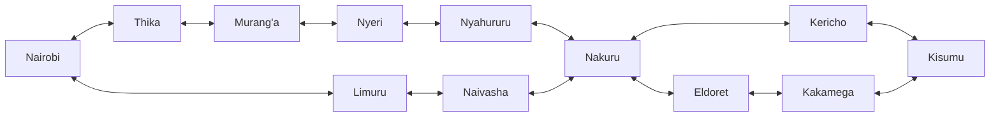
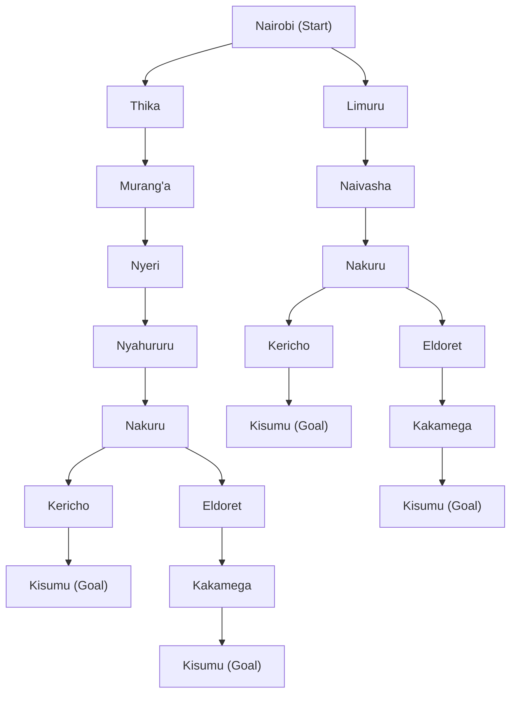

# Self-Driving Trailer Agent: Design

## 1. PEAS Framework

| Component | Description |
|---|---|
| **Performance measure** | Shortest total distance travelled, safe delivery of cargo, no collisions or traffic violations, fuel efficiency, on-time arrival |
| **Environment** | Kenya's highway network linking Nairobi, the Central Highlands, the Rift Valley and the Lake Victoria Basin. This includes roads, other vehicles, pedestrians, animals, weather, road works, junctions and towns |
| **Actuators** | Steering, accelerator, brakes, gear selection, indicators, headlights, horn, trailer coupling and braking system |
| **Sensors** | GPS, cameras, LIDAR/radar, speedometer, odometer, fuel gauge, gyroscope/accelerometer, trailer load sensors, tyre pressure sensors, digital road map |

## 2. Environment Properties

| Property | Classification | Justification |
|---|---|---|
| Observability | Partially observable | Sensors have limited range. The agent can't see around bends or know other drivers' intentions, or whether a road is blocked ahead |
| Agents | Multi-agent | Other drivers, matatus, motorbikes and pedestrians act independently, and they cooperate and compete for road space |
| Determinism | Stochastic | The next state is not fully predictable because of traffic, weather, accidents and breakdowns |
| Episodic or sequential | Sequential | Each decision (route, speed, lane) affects later states and later decisions |
| Static or dynamic | Dynamic | The environment keeps changing while the agent is deciding, e.g. moving traffic and changing weather |
| Discrete or continuous | Continuous | Speed, steering angle, position and time take continuous values. (Route choice between towns is discrete) |
## 3. Directed Graph of the Highway Network

## 4. Search Tree (Nairobi to Kisumu)

**Abstraction used:** Each state is only the town the trailer is currently in. Each action is "drive along the highway to a connected town". Minor stops between towns (e.g. Gilgil, Molo, Londiani), junctions, lanes, traffic and turns are left out. Towns already on the current path are not expanded again, so the tree has no loops. Goal states are marked **Kisumu (Goal)**.

**Branches left out:** Naivasha under the Thika side and Nyahururu under the Limuru side are not expanded. Both would lead back to a town already on the path (Nairobi), which only creates a loop. The search stops at a goal node and does not expand Kisumu further.

## 5. Path Cost and Optimal Path (Nairobi to Kisumu)

The path cost function is the distance between towns in kilometres, taken from Google Maps (fastest driving route). The cost of a path is the sum of the distances of its edges.

### 5.1 Distance between towns

| # | From | To | Distance (km) |
|---|---|---|---|
| 1 | Nairobi | Thika | 46.1 |
| 2 | Thika | Murang'a | 47.2 |
| 3 | Murang'a | Nyeri | 65.1 |
| 4 | Nyeri | Nyahururu | 104 |
| 5 | Nyahururu | Nakuru | 63.3 |
| 6 | Nairobi | Limuru | 40.5 |
| 7 | Limuru | Naivasha | 54.8 |
| 8 | Naivasha | Nakuru | 70 |
| 9 | Nakuru | Kericho | 107 |
| 10 | Kericho | Kisumu | 84 |
| 11 | Nakuru | Eldoret | 156 |
| 12 | Eldoret | Kakamega | 88 |
| 13 | Kakamega | Kisumu | 53 |

### 5.2 Cost of each path

| Path | Route | Calculation (km) | Total (km) |
|---|---|---|---|
| 1 | Nairobi, Thika, Murang'a, Nyeri, Nyahururu, Nakuru, Kericho, Kisumu | 46.1 + 47.2 + 65.1 + 104 + 63.3 + 107 + 84 | 516.7 |
| 2 | Nairobi, Thika, Murang'a, Nyeri, Nyahururu, Nakuru, Eldoret, Kakamega, Kisumu | 46.1 + 47.2 + 65.1 + 104 + 63.3 + 156 + 88 + 53 | 622.7 |
| 3 | Nairobi, Limuru, Naivasha, Nakuru, Kericho, Kisumu | 40.5 + 54.8 + 70 + 107 + 84 | **356.3** |
| 4 | Nairobi, Limuru, Naivasha, Nakuru, Eldoret, Kakamega, Kisumu | 40.5 + 54.8 + 70 + 156 + 88 + 53 | 462.3 |

### 5.3 Optimal path

The path with the lowest total cost is **Path 3**:

**Nairobi → Limuru → Naivasha → Nakuru → Kericho → Kisumu = 356.3 km**

It is 106.4 km shorter than the next best path (Path 4), so it is the optimal route for the trailer.
